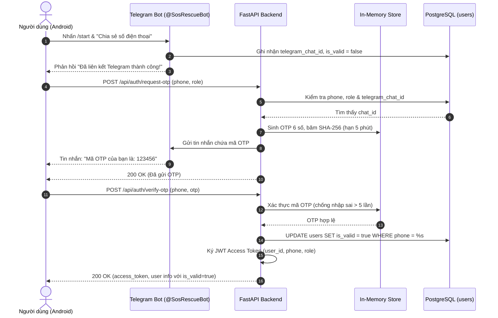
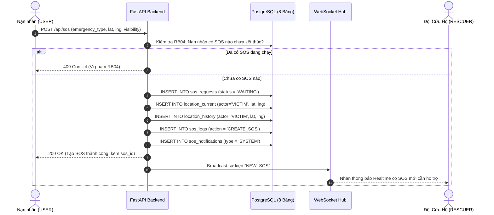
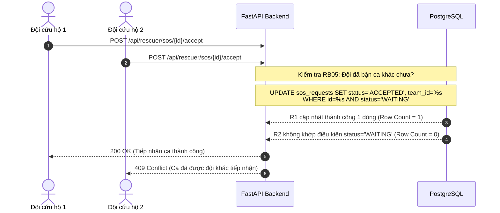
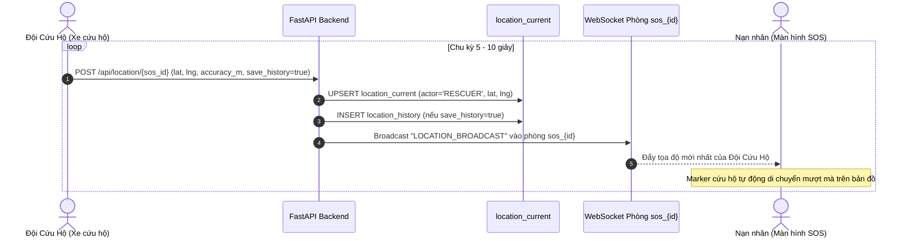
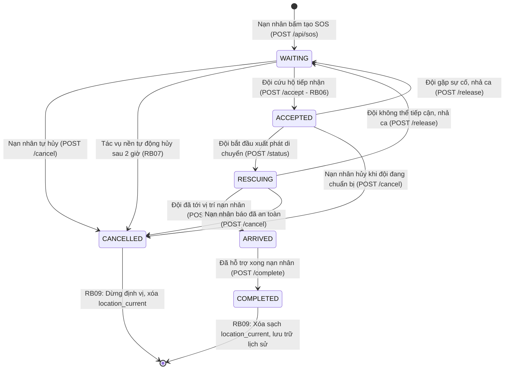

# ĐẶC TẢ CHI TIẾT API VÀ LUỒNG HOẠT ĐỘNG HỆ THỐNG CỨU HỘ KHẨN CẤP (SOS RESCUE)

> **Tài liệu tham chiếu chuẩn cho Frontend (Android Studio) & Vấn đáp Đồ án**  
> **Backend Stack:** Python 3.12 + FastAPI + PostgreSQL 17 + WebSocket + Telegram Bot API  
> **Địa chỉ kết nối (Base URL):**
> - Máy thật / Trình duyệt: `http://localhost:8000`
> - Máy ảo Android Emulator: `http://10.0.2.2:8000`
> - WebSocket URL: `ws://10.0.2.2:8000/ws`

---

## 1. Quy chuẩn Chung của Hệ Thống API

### 1.1 Header Chuẩn
- **`Content-Type: application/json`**: Bắt buộc với mọi request gửi dữ liệu (POST, PUT).
- **`Authorization: Bearer <access_token>`**: Bắt buộc với các API yêu cầu đăng nhập. `<access_token>` là chuỗi JWT nhận được sau khi gọi API xác thực OTP.

### 1.2 Bảng Mã Lỗi HTTP (Status Code)
| Mã HTTP | Tên chuẩn | Ý nghĩa trong hệ thống |
| :---: | :--- | :--- |
| **`200 OK`** | Thành công | Request hợp lệ, xử lý và trả về kết quả thành công. |
| **`400 Bad Request`** | Dữ liệu sai logic | Sai định dạng SĐT, OTP không đúng, sai thứ tự chuyển trạng thái. |
| **`401 Unauthorized`** | Chưa xác thực | Không gửi kèm Header `Authorization` hoặc Token đã hết hạn / không hợp lệ. |
| **`403 Forbidden`** | Không có quyền | Sai vai trò (VD: `USER` cố gọi API nhận ca của `RESCUER`) hoặc cố xem/sửa dữ liệu SOS của người khác. |
| **`404 Not Found`** | Không tìm thấy | Không tìm thấy tài khoản, SOS ID, thông báo hoặc tài nguyên yêu cầu. |
| **`409 Conflict`** | Xung đột nghiệp vụ | Vi phạm RB04 (1 nạn nhân chỉ có 1 SOS hoạt động), RB05 (đội cứu hộ chỉ nhận 1 ca), hoặc RB06 (hai đội tranh chấp nhận cùng 1 ca). |
| **`422 Unprocessable`** | Lỗi Validation | Dữ liệu không thỏa mãn Pydantic DTO (VD: vĩ độ > 90°, kinh độ > 180°, thiếu trường bắt buộc). |
| **`429 Too Many Req`** | Giới hạn tần suất | Spam yêu cầu OTP liên tục trong vòng 30 giây. |
| **`500 / 503`** | Lỗi máy chủ | Lỗi cơ sở dữ liệu hoặc sự cố máy chủ nội bộ. |

---

## 2. Bảng Tổng Hợp Tất Cả API Của Hệ Thống

| STT | Nhóm | Phương thức | Endpoint | Yêu cầu Auth | Mô tả chức năng chính |
| :---: | :--- | :---: | :--- | :---: | :--- |
| **01** | Xác thực | `POST` | `/api/auth/request-otp` | Không | Yêu cầu sinh mã OTP 6 số và gửi qua Telegram Bot |
| **02** | Xác thực | `POST` | `/api/auth/verify-otp` | Không | Xác minh OTP, chuyển `is_valid=true`, cấp JWT token |
| **03** | Xác thực | `GET` | `/api/auth/me` | Bearer Token | Lấy thông tin tài khoản đang đăng nhập |
| **04** | Xác thực | `POST` | `/api/auth/dev-link-telegram`| Không | Tiện ích liên kết nhanh SĐT với Telegram Chat ID (DEV) |
| **05** | Hồ sơ | `GET` | `/api/users/profile` | Bearer Token | Xem thông tin hồ sơ người dùng |
| **06** | Hồ sơ | `PUT` | `/api/users/full-name` | Bearer Token | Cập nhật lại họ tên người dùng (sau khi xác thực OTP) |
| **--** | Hồ sơ | `PUT` | `/api/users/profile` | Bearer Token | Cập nhật họ tên hiển thị (tương thích ngược) |
| **07** | SOS | `POST` | `/api/sos` | Bearer Token | Tạo yêu cầu cứu hộ SOS mới (nạp vào `location_current`) |
| **08** | SOS | `GET` | `/api/sos/my-active` | Bearer Token | Lấy phiên SOS đang hoạt động của nạn nhân kèm GPS |
| **09** | SOS | `GET` | `/api/sos/public/map` | Không | Lấy dữ liệu bản đồ cộng đồng (tọa độ làm tròn ~1km) |
| **10** | SOS | `GET` | `/api/sos/{id}` | Bearer Token | Xem chi tiết SOS (chỉ chủ SOS hoặc Rescuer được xem) |
| **11** | SOS | `PUT` | `/api/sos/{id}/visibility`| Bearer Token | Đổi chế độ hiển thị `PUBLIC` / `PRIVATE` |
| **12** | SOS | `POST` | `/api/sos/{id}/cancel` | Bearer Token | Nạn nhân hủy SOS (báo đã an toàn / gửi nhầm) |
| **13** | SOS | `GET` | `/api/sos/{id}/logs` | Bearer Token | Lấy nhật ký kiểm toán phiên cứu hộ (`sos_logs`) |
| **14** | Thông báo| `GET` | `/api/sos/notifications/my`| Bearer Token| Lấy danh sách thông báo người dùng (`sos_notifications`)|
| **15** | Thông báo| `PUT` | `/api/sos/notifications/{id}/read`| Bearer Token| Đánh dấu thông báo là đã đọc |
| **16** | Cứu hộ | `GET` | `/api/rescuer/queue` | Rescuer Token| Xem hàng đợi cứu hộ (các SOS `WAITING` < 2 giờ) |
| **17** | Cứu hộ | `GET` | `/api/rescuer/my-active` | Rescuer Token| Xem ca cứu hộ hiện tại của đội |
| **18** | Cứu hộ | `POST` | `/api/rescuer/sos/{id}/accept`| Rescuer Token| Đội cứu hộ tiếp nhận ca (nguyên tử RB06, kiểm tra RB05) |
| **19** | Cứu hộ | `POST` | `/api/rescuer/sos/{id}/status`| Rescuer Token| Cập nhật tiến trình: `RESCUING` -> `ARRIVED` |
| **20** | Cứu hộ | `POST` | `/api/rescuer/sos/{id}/release`| Rescuer Token| Nhả ca (quay về `WAITING`, xóa vị trí cứu hộ) |
| **21** | Cứu hộ | `POST` | `/api/rescuer/sos/{id}/complete`| Rescuer Token| Hoàn thành ca cứu hộ (`COMPLETED`, xóa vị trí realtime)|
| **22** | Cứu hộ | `GET` | `/api/rescuer/teams` | Rescuer Token| Lấy danh sách đội cứu hộ và thành viên (`rescue_teams`) |
| **23** | Định vị| `POST` | `/api/location/{sos_id}` | Bearer Token | Cập nhật GPS mới nhất, upsert `location_current` |
| **24** | Định vị| `GET` | `/api/location/{sos_id}/current`| Bearer Token| Lấy tọa độ mới nhất của 2 bên (`VICTIM` & `RESCUER`) |
| **25** | Định vị| `GET` | `/api/location/{sos_id}/trail` | Bearer Token| Lấy danh sách tọa độ lịch sử để vẽ Polyline |
| **26** | Realtime| `WS` | `/ws?token={jwt}` | Query / Auth | Kênh WebSocket hai chiều thời gian thực |
| **27** | Loại sự cố| `GET` | `/api/emergency-types` | Không | Lấy danh mục tất cả loại sự cố (phục vụ dropdown SOS) |
| **28** | Loại sự cố| `GET` | `/api/emergency-types/{id}`| Không | Lấy thông tin chi tiết một loại sự cố |
| **29** | Loại sự cố| `POST` | `/api/emergency-types` | Bearer Token | Tạo mới loại sự cố khẩn cấp |
| **30** | Loại sự cố| `PUT` | `/api/emergency-types/{id}`| Bearer Token | Cập nhật tên/mô tả loại sự cố |
| **31** | Loại sự cố| `DELETE` | `/api/emergency-types/{id}`| Bearer Token| Xóa loại sự cố (chặn xóa nếu đang có SOS sử dụng) |
| **32** | Hệ thống| `GET` | `/health` | Không | Kiểm tra trạng thái máy chủ và kết nối PostgreSQL |

---

## 3. Chi Tiết Từng API: Header, Input, Output & Ràng Buộc

### 3.1 Nhóm Xác Thực & Đăng Nhập (`/api/auth`)

#### 1. Yêu cầu gửi mã OTP (`POST /api/auth/request-otp`)
* **Mô tả:** Kiểm tra SĐT đã liên kết Telegram chưa và có đúng vai trò (`role`) không. Nếu hợp lệ thì sinh mã 6 số gửi qua tin nhắn Telegram.
* **Header:** `Content-Type: application/json`
* **Input (Body):**
```json
{
  "phone": "0901234567",
  "role": "USER"
}
```
* **Output Thành công (200 OK):**
```json
{
  "success": true,
  "message": "Mã OTP gồm 6 chữ số đã được gửi qua Telegram của bạn (hiệu lực 5 phút).",
  "phone": "0901234567",
  "expires_in_minutes": 5
}
```
* **Output Lỗi thường gặp:**
  - `400 Bad Request`: `"Số điện thoại này không thuộc đội cứu hộ nào (không có quyền RESCUER)."`
  - `400 Bad Request`: `"Số điện thoại này chưa được liên kết với Telegram Bot của hệ thống..."`
  - `422 Unprocessable Entity`: `"Vai trò không hợp lệ. Chỉ chấp nhận 'USER' hoặc 'RESCUER'."`
  - `429 Too Many Requests`: `"Vui lòng đợi 25 giây trước khi yêu cầu mã OTP mới."`

---

#### 2. Xác thực OTP & Đăng nhập (`POST /api/auth/verify-otp`)
* **Mô tả:** Xác minh OTP (RAM), chuyển `is_valid = true` cho tài khoản, cấp JWT token (thời hạn 1 ngày / 24 giờ). Khi tạo mới tài khoản, `full_name` mặc định được đặt bằng chính số điện thoại. Vai trò `role` được xác định động qua bảng `rescue_team_members`.
* **Header:** `Content-Type: application/json`
* **Input (Body):**
```json
{
  "phone": "0901234567",
  "otp": "123456"
}
```
* **Output Thành công (200 OK):**
```json
{
  "success": true,
  "is_new_user": false,
  "access_token": "eyJhbGciOiJIUzI1NiIsInR5cCI6IkpXVCJ9...",
  "token_type": "bearer",
  "user": {
    "id": "f4139613-5ddd-4d6a-888c-f79629762632",
    "full_name": "0901234567",
    "phone": "0901234567",
    "role": "USER",
    "account_status": "ACTIVE",
    "is_valid": true
  }
}
```
* **Output Lỗi thường gặp:**
  - `400 Bad Request`: `"Mã OTP không chính xác. Bạn còn 4 lần thử."`
  - `400 Bad Request`: `"Bạn đã nhập sai quá 5 lần. Mã OTP đã bị vô hiệu hóa hoàn toàn."`
  - `400 Bad Request`: `"Mã OTP đã hết hạn hoặc chưa được tạo."`

---

#### 2b. Cập nhật họ và tên người dùng (`PUT /api/users/full-name`)
* **Mô tả:** API chuyên biệt để người dùng cập nhật lại họ tên cá nhân sau khi xác thực OTP thành công.
* **Header:**
  - `Content-Type: application/json`
  - `Authorization: Bearer <access_token>`
* **Input (Body):**
```json
{
  "full_name": "Nguyễn Văn An"
}
```
* **Output Thành công (200 OK):**
```json
{
  "success": true,
  "message": "Cập nhật họ tên thành công.",
  "user": {
    "id": "f4139613-5ddd-4d6a-888c-f79629762632",
    "full_name": "Nguyễn Văn An",
    "phone": "0901234567",
    "role": "USER",
    "account_status": "ACTIVE",
    "is_valid": true
  }
}
```

---

#### 3. Lấy thông tin tài khoản hiện tại (`GET /api/auth/me`)
* **Header:** `Authorization: Bearer <token>`
* **Input:** Không có body
* **Output Thành công (200 OK):**
```json
{
  "success": true,
  "user": {
    "id": "f4139613-5ddd-4d6a-888c-f79629762632",
    "full_name": "Nguyễn Văn An",
    "phone": "0901234567",
    "role": "USER",
    "account_status": "ACTIVE",
    "is_valid": true
  }
}
```
* **Output Lỗi:** `401 Unauthorized` nếu token sai hoặc thiếu.

---

### 3.2 Nhóm Yêu Cầu Cứu Hộ SOS (`/api/sos`)

#### 1. Tạo yêu cầu SOS (`POST /api/sos`)
* **Mô tả:** Nạn nhân bấm nút SOS. Hệ thống tạo bản ghi `sos_requests` (`status = 'WAITING'`), ghi tọa độ ban đầu vào `location_current` và `location_history`, tự động ghi log vào `sos_logs`, thông báo vào `sos_notifications`, phát WebSocket `NEW_SOS` tới mọi cứu hộ.
* **Header:** `Content-Type: application/json`, `Authorization: Bearer <token>`
* **Input (Body):**
```json
{
  "emergency_type": "NGAP_LUT",
  "description": "Nước ngập tầng 1, cần xuồng đưa 2 người già di chuyển",
  "visibility": "PUBLIC",
  "initial_lat": 10.776889,
  "initial_lng": 106.700806
}
```
* **Output Thành công (200 OK):**
```json
{
  "success": true,
  "message": "Đã gửi tín hiệu cứu hộ SOS thành công. Đang kết nối tới đội cứu hộ gần nhất.",
  "sos": {
    "id": "2cc295a6-5723-4085-8dd8-1967ab544d31",
    "requester_id": "f4139613-5ddd-4d6a-888c-f79629762632",
    "emergency_type": "NGAP_LUT",
    "description": "Nước ngập tầng 1, cần xuồng đưa 2 người già di chuyển",
    "visibility": "PUBLIC",
    "initial_lat": 10.776889,
    "initial_lng": 106.700806,
    "status": "WAITING",
    "created_at": "2026-10-31T09:21:34.505611+07:00"
  }
}
```
* **Output Lỗi thường gặp:**
  - `409 Conflict`: `"Bạn đang có một yêu cầu SOS đang hoạt động chưa kết thúc."` (Ràng buộc RB04)
  - `422 Unprocessable Entity`: Vĩ độ ngoài khoảng `[-90, 90]` hoặc kinh độ ngoài `[-180, 180]`.

---

#### 2. Lấy SOS đang diễn ra của mình (`GET /api/sos/my-active`)
* **Mô tả:** Mobile App gọi khi mở app để kiểm tra xem nạn nhân có ca cứu hộ nào chưa đóng hay không.
* **Header:** `Authorization: Bearer <token>`
* **Output khi có SOS đang chạy (200 OK):**
```json
{
  "active": true,
  "sos": {
    "id": "2cc295a6-5723-4085-8dd8-1967ab544d31",
    "requester_id": "f4139613-5ddd-4d6a-888c-f79629762632",
    "team_id": "aaaaaaaa-aaaa-aaaa-aaaa-aaaaaaaaaaaa",
    "emergency_type": "NGAP_LUT",
    "description": "Nước ngập tầng 1...",
    "visibility": "PUBLIC",
    "status": "ACCEPTED",
    "created_at": "2026-10-31T09:21:34.505611+07:00",
    "rescuer": {
      "id": "11111111-1111-1111-1111-111111111111",
      "full_name": "Trần Cứu Hộ",
      "phone": "0901112222",
      "team_name": "Đội Cứu Hộ Phản Ứng Nhanh Quận 1"
    },
    "locations": {
      "VICTIM": { "lat": 10.77695, "lng": 106.70085, "accuracy_m": 4.5 },
      "RESCUER": { "lat": 10.77100, "lng": 106.69500, "accuracy_m": 8.0 }
    }
  }
}
```
* **Output khi không có ca nào:** `{"active": false, "sos": null}`.

---

#### 3. Bản đồ cộng đồng (`GET /api/sos/public/map`)
* **Mô tả:** Dành cho người dân xem cảnh báo ngập lụt, tai nạn xung quanh. Tọa độ được làm tròn 2 chữ số (~1km) để bảo mật vị trí chính xác của nhà nạn nhân.
* **Header:** Không bắt buộc Auth
* **Output (200 OK):**
```json
{
  "success": true,
  "count": 1,
  "data": [
    {
      "sos_id": "2cc295a6-5723-4085-8dd8-1967ab544d31",
      "emergency_type": "NGAP_LUT",
      "area_lat": 10.78,
      "area_lng": 106.70,
      "created_at": "2026-10-31T09:21:34.505611+07:00"
    }
  ]
}
```

---

#### 4. Nạn nhân hủy SOS (`POST /api/sos/{id}/cancel`)
* **Mô tả:** Nạn nhân báo an toàn hoặc bấm nhầm. Cập nhật `status = 'CANCELLED'`, xóa dữ liệu realtime khỏi `location_current` (RB09), ghi log vào `sos_logs`.
* **Header:** `Authorization: Bearer <token>`
* **Path Param:** `id` (UUID của SOS)
* **Output (200 OK):**
```json
{
  "success": true,
  "message": "Đã hủy yêu cầu SOS thành công. Dừng theo dõi vị trí.",
  "status": "CANCELLED",
  "end_reason": "USER_CANCELLED"
}
```

---

### 3.3 Nhóm Nghiệp Vụ Đội Cứu Hộ (`/api/rescuer` - Yêu cầu Role RESCUER)

#### 1. Xem hàng đợi cứu hộ (`GET /api/rescuer/queue`)
* **Mô tả:** Đội cứu hộ lấy danh sách mọi SOS đang ở trạng thái `WAITING` trong vòng 2 giờ qua View `rescue_queue`.
* **Header:** `Authorization: Bearer <rescuer_token>`
* **Output (200 OK):**
```json
{
  "success": true,
  "count": 1,
  "data": [
    {
      "sos_id": "2cc295a6-5723-4085-8dd8-1967ab544d31",
      "emergency_type": "NGAP_LUT",
      "visibility": "PUBLIC",
      "initial_lat": 10.776889,
      "initial_lng": 106.700806,
      "created_at": "2026-10-31T09:21:34.505611+07:00",
      "description": "Nước ngập tầng 1, cần xuồng đưa 2 người già di chuyển",
      "requester": {
        "full_name": "Nguyễn Văn An",
        "phone": "0901234567"
      }
    }
  ]
}
```

---

#### 2. Tiếp nhận yêu cầu cứu hộ (`POST /api/rescuer/sos/{id}/accept`)
* **Mô tả:** Tiếp nhận ca cứu trợ. Thực thi câu lệnh `UPDATE` có điều kiện nguyên tử (RB06), gắn `team_id` của đội cứu hộ vào `sos_requests`. Tự động đẩy sự kiện WebSocket cho nạn nhân.
* **Header:** `Authorization: Bearer <rescuer_token>`
* **Path Param:** `id` (UUID của SOS)
* **Output Thành công (200 OK):**
```json
{
  "success": true,
  "message": "Đã tiếp nhận yêu cầu cứu hộ thành công. Bắt đầu phiên điều phối.",
  "sos_id": "2cc295a6-5723-4085-8dd8-1967ab544d31",
  "status": "ACCEPTED"
}
```
* **Output Lỗi thường gặp:**
  - `409 Conflict`: `"Bạn đang có một ca cứu hộ đang xử lý. Mỗi đội chỉ được nhận một ca tại một thời điểm (RB05)."`
  - `409 Conflict`: `"Yêu cầu SOS này đã được đội khác tiếp nhận, đã bị hủy hoặc quá thời hạn tiếp nhận."` (RB06 Atomic Check)

---

#### 3. Cập nhật tiến trình tuần tự (`POST /api/rescuer/sos/{id}/status`)
* **Mô tả:** Đội cứu hộ cập nhật trạng thái di chuyển. Bắt buộc tuần tự: `ACCEPTED` -> `RESCUING` (đang di chuyển) -> `ARRIVED` (đã tới nơi).
* **Header:** `Content-Type: application/json`, `Authorization: Bearer <rescuer_token>`
* **Input (Body):**
```json
{
  "status": "RESCUING"
}
```
hoặc:
```json
{
  "status": "ARRIVED"
}
```
* **Output Thành công (200 OK):**
```json
{
  "success": true,
  "message": "Đã cập nhật trạng thái sang RESCUING.",
  "sos_id": "2cc295a6-5723-4085-8dd8-1967ab544d31",
  "status": "RESCUING"
}
```
* **Output Lỗi:** `400 Bad Request` nếu cố nhảy cóc trạng thái (VD: từ `ACCEPTED` nhảy thẳng lên `ARRIVED`).

---

#### 4. Nhả ca cứu hộ (`POST /api/rescuer/sos/{id}/release`)
* **Mô tả:** Đội cứu hộ gặp sự cố xe hỏng/không tiếp cận được, nhả ca để đội khác nhận.
* **Điều kiện:** Chỉ cho phép khi trạng thái đang là `ACCEPTED` hoặc `RESCUING` (chưa `ARRIVED`).
* **Tác động:** `status` quay về `WAITING`, `team_id = NULL`, xóa vị trí của cứu hộ trong `location_current`, đưa SOS trở lại `rescue_queue`.
* **Output (200 OK):**
```json
{
  "success": true,
  "message": "Đã nhả ca thành công. SOS đã trở lại hàng đợi chờ đội khác tiếp nhận.",
  "sos_id": "2cc295a6-5723-4085-8dd8-1967ab544d31",
  "status": "WAITING"
}
```

---

#### 5. Hoàn thành ca cứu hộ (`POST /api/rescuer/sos/{id}/complete`)
* **Mô tả:** Đã đưa nạn nhân đến nơi an toàn. Đóng phiên cứu hộ.
* **Điều kiện:** Phải ở trạng thái `ARRIVED`.
* **Tác động:** `status = 'COMPLETED'`, xóa sạch dòng `location_current` (RB09), giải phóng đội cứu hộ để nhận ca mới.
* **Output (200 OK):**
```json
{
  "success": true,
  "message": "Phiên cứu hộ đã hoàn thành xuất sắc. Ca của bạn đã được giải phóng.",
  "sos_id": "2cc295a6-5723-4085-8dd8-1967ab544d31",
  "status": "COMPLETED",
  "end_reason": "RESCUER_COMPLETED"
}
```

---

### 3.4 Nhóm Định Vị GPS & Lộ Trình Di Chuyển (`/api/location`)

#### 1. Gửi vị trí GPS mới nhất (`POST /api/location/{sos_id}`)
* **Mô tả:** Mobile app chạy định kỳ (5–10 giây một lần) gửi tọa độ hiện tại lên server. Server tự nhận diện caller là `VICTIM` hay `RESCUER`, ghi đè vào `location_current` và broadcast ngay cho đối phương qua WebSocket.
* **Header:** `Content-Type: application/json`, `Authorization: Bearer <token>`
* **Input (Body):**
```json
{
  "lat": 10.77695,
  "lng": 106.70085,
  "accuracy_m": 4.5,
  "save_history": true
}
```
* **Output (200 OK):**
```json
{
  "success": true,
  "actor": "VICTIM",
  "lat": 10.77695,
  "lng": 106.70085,
  "updated_at": "2026-10-31T09:21:36.053844+00:00"
}
```

---

#### 2. Lấy vị trí hiện tại của 2 bên (`GET /api/location/{sos_id}/current`)
* **Mô tả:** Lấy marker tọa độ mới nhất của cả nạn nhân và cứu hộ để hiển thị bản đồ.
* **Output (200 OK):**
```json
{
  "success": true,
  "sos_id": "2cc295a6-5723-4085-8dd8-1967ab544d31",
  "locations": {
    "VICTIM": {
      "lat": 10.77695,
      "lng": 106.70085,
      "accuracy_m": 4.5,
      "updated_at": "2026-10-31T09:21:36.053844+07:00"
    },
    "RESCUER": {
      "lat": 10.77100,
      "lng": 106.69500,
      "accuracy_m": 8.0,
      "updated_at": "2026-10-31T09:21:36.059877+07:00"
    }
  }
}
```

---

#### 3. Lấy Polyline lộ trình di chuyển (`GET /api/location/{sos_id}/trail`)
* **Mô tả:** Lấy danh sách điểm tọa độ từ bảng `location_history` để vẽ đường Polyline trên Google Map.
* **Query Params:** `actor=RESCUER` (tùy chọn), `limit=100` (mặc định 100, max 500).
* **Output (200 OK):**
```json
{
  "success": true,
  "sos_id": "2cc295a6-5723-4085-8dd8-1967ab544d31",
  "count": 3,
  "trail": [
    { "id": "uuid-1", "actor": "RESCUER", "lat": 10.770, "lng": 106.690, "recorded_at": "2026-10-31T09:21:30" },
    { "id": "uuid-2", "actor": "RESCUER", "lat": 10.771, "lng": 106.692, "recorded_at": "2026-10-31T09:21:45" },
    { "id": "uuid-3", "actor": "RESCUER", "lat": 10.773, "lng": 106.696, "recorded_at": "2026-10-31T09:22:00" }
  ]
}
```

---

### 3.5 Kênh WebSocket Real-time (`ws://10.0.2.2:8000/ws`)

#### Cách thức kết nối & Đăng ký phòng:
1. **Kết nối:** `ws://10.0.2.2:8000/ws?token=<JWT_TOKEN>`
2. **Ping-Pong giữ kết nối:** Gửi `{"type": "PING"}` -> Nhận `{"type": "PONG"}`.
3. **Đăng ký lắng nghe phòng SOS:** Gửi `{"type": "SUBSCRIBE_SOS", "sos_id": "<UUID>"}`.
4. **Các sự kiện Server tự động đẩy về Client (Server-Sent Events qua WS):**
   - **`NEW_SOS`**: Phát tới các `RESCUER` khi có SOS mới hoặc có ca vừa được nhả lại.
   - **`SOS_ACCEPTED`**: Báo cho Nạn nhân biết đội cứu hộ đã tiếp nhận ca.
   - **`STATUS_CHANGED`**: Báo tiến trình di chuyển (`RESCUING`, `ARRIVED`).
   - **`LOCATION_BROADCAST`**: Tọa độ GPS di chuyển thời gian thực của đối phương.
   - **`SOS_RELEASED`**: Báo cho Nạn nhân biết đội cứu hộ đã nhả ca.
   - **`SOS_COMPLETED`**: Báo hoàn tất cứu hộ.
   - **`SOS_CANCELLED`**: Báo hủy cứu hộ.
   - **`QUEUE_UPDATED`**: Báo cập nhật danh sách chờ cho toàn bộ RESCUER.

---

## 4. Các Luồng Hoạt Động Chi Tiết (Flow Diagrams)

### Luồng 1: Xác Thực Đăng Ký / Đăng Nhập Bằng OTP Telegram
Cơ chế bảo mật không mật khẩu (Passwordless). Mỗi lần đăng nhập, hệ thống cấp OTP 6 số qua Telegram Bot, kiểm tra trong RAM và cấp JWT token.



---

### Luồng 2: Khởi Tạo Tín Hiệu SOS (Nạn nhân gửi cứu trợ)
Nạn nhân bấm nút khẩn cấp, máy chủ kiểm tra ràng buộc duy nhất RB04 và thông báo tức thời cho toàn bộ đội cứu hộ xung quanh qua WebSocket.



---

### Luồng 3: Đội Cứu Hộ Tiếp Nhận Ca (Atomic Update RB06 & RB05)
Đảm bảo khi có nhiều đội cùng bấm "Nhận ca" vào một phần nghìn giây, chỉ có đúng một đội thành công nhờ câu lệnh UPDATE nguyên tử trong Database.



---

### Luồng 4: Di Chuyển & Cập Nhật Tọa Độ Realtime (Live Tracking)
Định vị GPS truyền liên tục giúp cả nạn nhân và đội cứu hộ nhìn thấy nhau đang di chuyển trên bản đồ.



---

### Luồng 5: Máy Trạng Thái Toàn Vẹn Vòng Đời SOS (State Machine Lifecycle)
Sơ đồ thể hiện toàn bộ các trạng thái khả dĩ của một yêu cầu cứu hộ từ khi mở đến khi kết thúc an toàn.



---

## 5. Cẩm Nang Trả Lời Vấn Đáp Giảng Viên Về Backend & API

Khi thầy cô vấn đáp về phần Backend và Cơ sở dữ liệu, bạn có thể tự tin trả lời theo các luận điểm kỹ thuật sau:

1. **Tại sao không lưu tọa độ nạn nhân `initial_lat`, `initial_lng` trực tiếp trong bảng `sos_requests`?**
   > *"Dạ thưa thầy/cô, theo nguyên tắc chuẩn hóa dữ liệu quan hệ (ERD), vị trí của một đối tượng luôn biến đổi theo thời gian. Chúng em đã thiết kế bảng chuyên trách `location_current` để lưu tọa độ hiện tại của cả nạn nhân (`VICTIM`) lẫn người cứu hộ (`RESCUER`). Khi cần hiển thị danh sách cứu hộ hay bản đồ cộng đồng, hệ thống sử dụng Database View (`rescue_queue`, `public_sos_map`) để JOIN tự động. Cách làm này tránh việc dữ liệu bị trùng lặp (redundancy) và đảm bảo tính nhất quán (data consistency) khi nạn nhân di chuyển."*

2. **Hệ thống giải quyết vấn đề Tranh chấp đồng thời (Concurrency / Race Condition) khi nhiều đội cùng nhận một ca như thế nào?**
   > *"Dạ thưa thầy/cô, chúng em áp dụng cơ chế Cập nhật nguyên tử (Atomic Update) ở mức Database với điều kiện `WHERE id = %s AND status = 'WAITING'`. Cơ sở dữ liệu PostgreSQL sử dụng cơ chế khóa mức dòng (Row-level Locking) khi thực hiện câu lệnh UPDATE, nên chỉ có duy nhất một giao dịch đầu tiên thay đổi được trạng thái sang `ACCEPTED`. Giao dịch thứ hai đến sau sẽ có số dòng cập nhật bằng 0 và API lập tức trả về mã lỗi `409 Conflict`."*

3. **Tại sao không dùng mật khẩu mà lại dùng OTP qua Telegram Bot?**
   > *"Dạ thưa thầy/cô, trong các tình huống khẩn cấp hoặc cứu nạn, người dùng thường bị hoảng loạn và rất dễ quên mật khẩu phức tạp. Việc sử dụng đăng nhập không mật khẩu (Passwordless Authentication) qua số điện thoại và OTP gửi qua Telegram giúp nạn nhân đăng nhập nhanh chóng. Hơn nữa, chúng em quản lý mã OTP trực tiếp trong bộ nhớ RAM máy chủ kèm thuật toán băm SHA-256, tự động hủy sau 5 phút hoặc sau 5 lần nhập sai, giúp hệ thống vừa an toàn vừa có tốc độ phản hồi cực nhanh dưới 10ms."*

4. **Khi một phiên SOS kết thúc (Hoàn thành hoặc Hủy), dữ liệu GPS được xử lý ra sao?**
   > *"Dạ theo ràng buộc nghiệp vụ RB09, ngay khi SOS chuyển sang `COMPLETED` hoặc `CANCELLED`, hệ thống lập tức xóa dòng tương ứng trong bảng `location_current` để giải phóng bộ nhớ và ngừng việc theo dõi GPS, đảm bảo quyền riêng tư cho người dùng. Toàn bộ hành trình di chuyển trước đó vẫn được lưu trữ toàn vẹn trong bảng `location_history` để phục vụ xem lại lộ trình (Polyline) hoặc đối soát sau này."*
